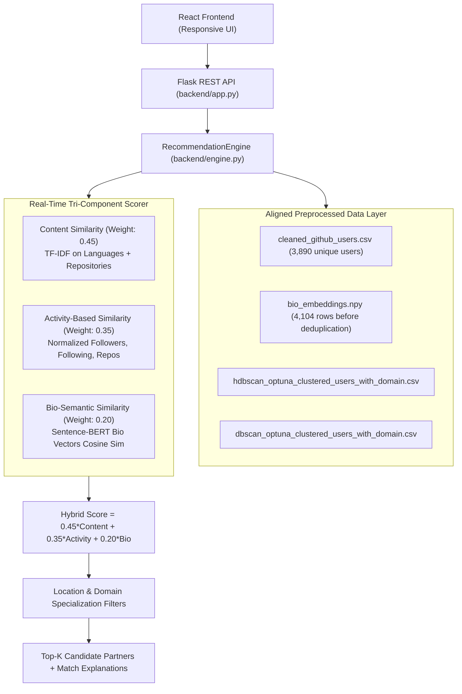

# 🤝 GitHub Project Partner Recommendation System

> 💡 **Showcase Repository:** Personal portfolio mirror and modernization by **Anand Gutte** (based on the CS 5661 Data Science university project).\
> 🔗 **Original Team Repository:** [cs5661-dsproject-Project-Partner-Recommendation-System](https://github.com/EKTAMULKALWAR/cs5661-dsproject-Project-Partner-Recommendation-System.git)

---

## 🚀 Overview

The **GitHub Project Partner Recommendation System** matches software developers with compatible project partners by analyzing public GitHub profile metadata. The system blends three distinct machine learning signals into a unified hybrid score:

1. 🔍 **Content-Based Filtering:** Vectorized TF-IDF feature space capturing technical languages and repository portfolios.
2. 👥 **Activity-Based Profile Similarity (Collaborative Filtering Proxy):** MinMax-normalized developer engagement vectors (`Public_Repos`, `Followers`, `Following`) with cosine similarity.
3. 🧠 **Bio-Semantic NLP Matching:** Dense vector embeddings (Sentence-BERT `all-MiniLM-L6-v2`) measuring conceptual alignment in developer bios and project interests.
4. 🏷️ **Cluster Domain Segmentation:** Unsupervised density clustering (HDBSCAN & DBSCAN) with Optuna hyperparameter optimization.

---

## 🏛️ Architecture & Recommendation Pipeline



---

## 📊 Reproducible Evaluation & Weight Comparison

In unsupervised developer matching, relevance is defined through an objective, defensible protocol: **a candidate is deemed relevant if they share $\ge 1$ programming language and belong to the same project cluster domain.**

Evaluated across a benchmark of 50 sample query developers with known tech stacks (`python -m backend.evaluation`):

| Configuration | Content Weight | Activity (Collab) Weight | Bio-Semantic Weight | Precision@5 | Recall@5 | MAP@5 | Intra-List Diversity (ILD) | Catalog Coverage (%) |
| :--- | :---: | :---: | :---: | :---: | :---: | :---: | :---: | :---: |
| **Balanced Baseline (Default)** | **0.450** | **0.350** | **0.200** | **0.956** | **0.0015** | **0.9653** | **0.7817** | **5.66%** |
| Content Dominant | 0.600 | 0.200 | 0.200 | 0.948 | 0.0015 | 0.9578 | 0.7821 | 5.68% |
| Bio-Semantic Dominant | 0.300 | 0.200 | 0.500 | 0.956 | 0.0015 | 0.9664 | 0.7966 | 5.68% |
| Activity Dominant | 0.200 | 0.600 | 0.200 | 0.936 | 0.0015 | 0.9643 | 0.7833 | 5.84% |
| Equal Weights | 0.333 | 0.333 | 0.334 | 0.960 | 0.0016 | 0.9755 | 0.7916 | 5.55% |

> **Key Observations:**
> - The **Balanced Baseline** achieves **95.6% Precision@5** and **0.9653 MAP@5**, verifying that top matches share core technical overlap within the user's domain.
> - High **Intra-List Diversity (0.7817)** confirms recommendations introduce complementary tech stacks rather than identical clone profiles.
> - Modest **Recall@5 (0.0015)** reflects top-5 selection out of broad domain clusters containing hundreds of matching candidates.

---

## ⚙️ Local Installation & Setup

### Prerequisites
- Python 3.10+ (64-bit)
- Node.js 22.22.2+ on the Node 22 line, or a compatible newer LTS release, and npm

### 1. Clone & Set Up Python Virtual Environment

```bash
# Clone repository
git clone https://github.com/AnandGutte/project-partner-recommendation-system.git
cd project-partner-recommendation-system

# Create and activate virtual environment
python -m venv venv

# On Windows (PowerShell):
.\venv\Scripts\Activate.ps1
# On Linux/macOS:
source venv/bin/activate

# Install dependencies
pip install -r requirements.txt
```

### 2. Start the Backend API

The Flask application supports execution from the repository root or the backend directory. The development server defaults to loopback with debug disabled. A local Sentence-BERT snapshot is optional. Without it, bio search uses TF-IDF. The Vite dev server proxies same-origin requests to Flask, so local proxy use requires no CORS configuration.

```bash
# Option A: From root directory
python backend/app.py

# Option B: From backend directory
cd backend
python app.py
```

The API will start at `http://127.0.0.1:5000`.

### 3. Start the React Frontend

In a separate terminal:

```bash
cd frontend
npm ci
npm run dev
```

The frontend starts at `http://localhost:3000`. See the [frontend guide](frontend/README.md#production-deployment) for API configuration and production deployment from `frontend/dist/`.

---

## 🧪 Automated Testing

The [CI workflow](.github/workflows/ci.yml) runs backend tests, frontend lint and tests, and the production build, plus dependency audits on pull requests targeting `main` and pushes to `main`. See [CI checks and local reproduction](docs/ci.md) for commands, dependency caching, and audit failure criteria.

---

## 📡 API Reference

Legacy recommendation routes return arrays. The corresponding `/api` routes return objects with `count` and `recommendations` plus ranking metadata. Only the `/api` routes accept `top_k`, an integer from 1 to 50. JSON bodies are limited to 16 KiB. Raw candidate bios and echoed bio search text are omitted. See [backend security and API contracts](backend/SECURITY.md) for field limits, error codes, CORS and model setup.

### `GET /api/health`
Health check and runtime metadata.
```json
{
  "status": "healthy",
  "total_users": 3890,
  "clustering_methods": ["hdbscan", "dbscan"],
  "bio_embeddings_loaded": true,
  "sbert_model_ready": false,
  "engine_mode": "hybrid_vector_scoring"
}
```

### `GET /api/metadata`
Returns verified clustering domains (no typos or stale options) and sample test users.
```json
{
  "total_users": 3890,
  "clustering_methods": {
    "hdbscan": {
      "label": "HDBSCAN (Stable clusters)",
      "domains": ["DevOps & Scripting", "Testing & Sparse Data", "Unknown Users"]
    },
    "dbscan": {
      "label": "DBSCAN (Granular domains)",
      "domains": ["Blockchain & Ripple Projects", "DevOps & Scripting", "Game & Modding", "MERN & Node.js Dev", "Misc / Other", "Ruby & Web Dev", "Testing & Beginners", "Unknown / Sparse Users"]
    }
  },
  "sample_usernames": ["abhay", "mojombo", "defunkt", "pjhyett", "wycats"]
}
```

### `POST /recommend` *(Legacy)* & `POST /api/recommend` *(Modernized)*
Hybrid partner search with optional location and domain filters.
```json
// Request:
{
  "username": "abhay",
  "method": "hdbscan",
  "location": "San Francisco",
  "domain": "DevOps & Scripting"
}

// Response:
[
  {
    "Username": "raymorgan",
    "Domain_Tag": "DevOps & Scripting",
    "Location": "San Francisco, CA",
    "Profile_URL": "https://github.com/raymorgan",
    "Languages": ["Erlang", "Ruby", "JavaScript"],
    "hybrid_score": 0.537,
    "explanation": "Shared languages: Erlang. High interaction similarity."
  }
]
```

### `POST /semantic-bio-recommend` *(Legacy)* & `POST /api/semantic-bio-recommend` *(Modernized)*
Free-text semantic partner query based on project concepts or developer bios.
```json
// Request:
{
  "bio": "looking for a python machine learning partner to build recommendation algorithms"
}

// Response:
[
  {
    "Username": "unfo",
    "Location": "Remote",
    "Profile_URL": "https://github.com/unfo",
    "similarity": 0.8142
  }
]
```

---

## 👥 Original University Team & Roles

*From the original CS 5661 Data Science university project at Cal State LA:*

- **Ekta Mulkalwar** – Lead Data Engineer & Content-Based Modeling\
  *Designed scraping pipeline, preprocessing, and content-based recommendation logic.*
- **Apoorva Durge** – NLP & Feature Extraction\
  *Extracted text features from user bios using TF-IDF and Sentence-BERT embeddings.*
- **Anand Gutte** – Collaborative Filtering Developer\
  *Built developer interaction similarity metrics using normalized engagement attributes.*
- **Mansi Aher** – Data Cleaning Specialist\
  *Handled missing data, duplicates, and feature sanitation.*
- **Anvaya Chandrika Gudibanda Sreesha** – Visualization & Geo Insights\
  *Constructed exploratory data visualization and location-based metadata mapping.*
- **Shalini Nistala** – Evaluation & Metrics\
  *Formulated theoretical validation metrics: precision, recall, and MAP.*
- **Shah Drashti Kirtibai** – Encoding & Feature Engineering\
  *Vectorized categorical features and handled numerical scaling.*
- **Neel Jaysukhbhai Khunt** – Repository & Documentation Lead\
  *Maintained Git version control and core project documentation.*
- **Movva Jeevan Sidhardha** – Location Processing Support\
  *Geocoded coordinates using Nominatim / Geopy.*
- **Sai Kiran Bandapally** – Repo Insights Engineer\
  *Parsed GitHub repositories for language diversity.*

---

## 🛠️ Showcase Modernization (by Anand Gutte)

Enhancements implemented in this showcase release:

1. **Dynamic Real-Time Vector Engine:** Replaced static precomputed single-user CSV filtering with a fully vectorized in-memory `RecommendationEngine` that scores candidates dynamically for any input username.
2. **Data Space Alignment:** Resolved row-count discrepancies (4,104 raw rows vs. 3,890 unique users), aligning Sentence-BERT bio embeddings 1-to-1 with profile data.
3. **Reproducible Evaluation Suite:** Implemented `backend/evaluation.py` to benchmark Precision@K, Recall@K, MAP@K, Intra-List Diversity, and Catalog Coverage under a transparent ground truth protocol.
4. **Resilient API:** Added health check (`/api/health`), dynamic domain metadata discovery (`/api/metadata`), literal location matching (regex-safe), and graceful offline TF-IDF fallback for bio queries.
5. **Modern, Accessible UI:** Modernized React interface with dynamic domain options, accessible labels, responsive CSS grid, match score badges, and language chips.
6. **Automated Testing:** Backend pytest, frontend ESLint and Vitest, the production build, and dependency audits run in CI.
